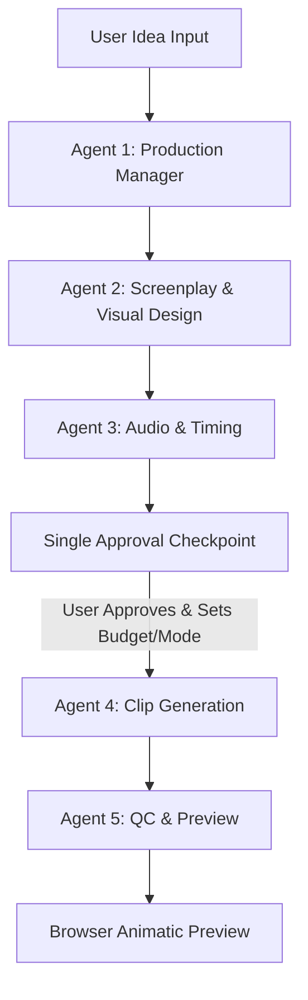

# AI Movie Maker Architecture and Implementation Plan

## 1. Introduction for Beginners: What is an AI Movie Maker?
An AI Movie Maker project transforms a simple text prompt (e.g., "A sci-fi noir detective story in Budapest") into an **Animatic / Storyboard Preview** consisting of structured scenes, AI-generated or stock video shots, synchronized Hungarian speech/subtitles, and playable preview in the browser.

In this architecture, the system uses **5 specialized steps (called "agents")** where Agents 1 and 2 use Google Gemini LLM intelligence, while Agents 3, 4, and 5 are robust backend code routines (non-AI deterministic logic) that handle audio timing, media sourcing (Pixabay stock or Fal.ai premium video), quality control, and browser preview assembly.

---

## 2. The 5-Agent Workflow & Dependencies

### Agent Breakdown & Dependencies:
1. **Agent 1 — Production Manager (Gemini LLM):**
   - **Input:** User premise / idea.
   - **Output:** Three-act scene structure, missing assets manifest.
   - **Dependency:** None (first step).
2. **Agent 2 — Screenplay and Visual Design (Gemini LLM):**
   - **Input:** Scene structure from Agent 1.
   - **Output:** Hungarian screenplay, stable character/location definitions, and shot list with English visual prompts (`visual_prompt_en`) and Hungarian dialogue (`dialogue_hu`).
   - **Dependency:** Depends on Agent 1 output.
3. **Agent 3 — Audio and Timing (Code):**
   - **Input:** Shot list with dialogue.
   - **Output:** Stored TTS audio files (via Gemini TTS) or subtitle fallback with estimated durations, locked shot durations.
   - **Dependency:** Depends on Agent 2 shot list. Required before any clip generation or approval estimation.
4. **Single Approval Checkpoint (User Gate):**
   - **Logic:** Displays editable screenplay, characters, shots, audio status, estimated costs, and mode selection (**Free Stock** vs. **Premium AI**). No paid work happens before this approval!
5. **Agent 4 — Clip Generation (Code):**
   - **Input:** Approved shots, selected mode, budget cap.
   - **Mode A (Free Stock):** Searches Pixabay using extracted keywords, downloads landscape videos, validates duration/playability, assigns attribution. Cost: 0.
   - **Mode B (Premium AI):** Calls Fal.ai video generation models after strict server-side budget checks and reference image generation.
   - **Dependency:** Depends on user approval at the checkpoint.
6. **Agent 5 — Quality Control and Preview (Code):**
   - **Input:** Generated media assets.
   - **Output:** QC pass (`qc_ok`) or review flag (`needs_review`), sequential animatic preview player with audio/subtitles.

---

## 3. Critical Edge Cases and Mitigation Strategies

| Edge Case | Description | Mitigation Strategy |
|---|---|---|
| **Gemini JSON Malformation** | LLM outputs invalid JSON or markdown wrappers. | Enforce `responseMimeType: application/json`, validate with Zod/server schema, allow exactly 1 repair attempt before failing safely. |
| **TTS Quota Exceeded / Unavailable** | Gemini TTS hits rate limits (429) or is not configured. | Never fake audio. Fallback gracefully to Hungarian subtitles with estimated duration (`duration_estimated = true`) and label **"becsült időtartam"**. |
| **Budget Overrun on Premium AI** | Fal.ai generation costs exceed user's approved cap. | Strict server-side budget check before every paid API call (actual spend + pending costs + next shot cost). Stop if over cap. |
| **Stock Video Duration Mismatch** | Pixabay stock video duration differs significantly from locked shot duration. | If duration difference exceeds 2 seconds, automatically mark shot as `needs_review`. Trim or hold last frame during preview. |
| **API Timeouts / Network Failures** | External provider hangs or fails mid-generation. | Log a `generation_jobs` record with `provider_job_id` before calling. Reconcile existing jobs on retry; never submit duplicate paid jobs. |
| **Corrupt / Empty Media Files** | Downloaded video file is zero bytes or unplayable. | Download to temporary storage, validate file header/size/playability before marking `clip_ready`. |

---

## 4. Testing Strategy and Verification Checkpoints

1. **Environment & Setup Verification (`/setup`):**
   - Test Supabase connection, database migrations (`supabase/migrations/001_initial_schema.sql`), and Gemini API key validity.
2. **Agent 1 & 2 Unit Testing:**
   - Test raw idea submission with Gemini API. Verify structured JSON output and error handling on safety blocks.
3. **Audio & Timing Testing (Agent 3):**
   - Verify Gemini TTS endpoint or fallback subtitle generation when API key is missing or quota is reached.
4. **Approval Checkpoint Testing:**
   - Verify that no paid calls are made before clicking **"Jóváhagyás és gyártás indítása"**.
5. **Clip Generation & Storage Testing (Agent 4):**
   - Test Pixabay stock search and download in Free mode. Verify storage persistence and attribution labels (**"Stock videó (AI-generálás nélkül)"**).
6. **Preview & QC Testing (Agent 5):**
   - Test sequential browser playback with audio and subtitles. Verify ZIP export fallback when assembly service is unconfigured.

---

## 5. Step-by-Step Implementation Todo List

- [ ] **Step 1:** Complete Database Schema & Supabase Setup (`supabase/migrations/001_initial_schema.sql`).
- [ ] **Step 2:** Build Dashboard & Project Setup UI (`src/app/page.tsx`, `src/app/setup/page.tsx`).
- [ ] **Step 3:** Implement Gemini Agents 1 & 2 with robust JSON schema validation and versioning.
- [ ] **Step 4:** Implement Agent 3 (Gemini TTS, audio storage, timing, subtitle fallback).
- [ ] **Step 5:** Build Approval Checkpoint UI with budget cap, mode selector (`stock`/`premium`), and cost calculation.
- [ ] **Step 6:** Implement Agent 4 (Pixabay stock search, download, validation, attribution; Fal.ai stubs).
- [ ] **Step 7:** Implement Agent 5 (QC checks, sequential animatic preview player, ZIP download fallback).
- [ ] **Step 8:** Comprehensive integration testing across refresh, timeout recovery, and error states.
