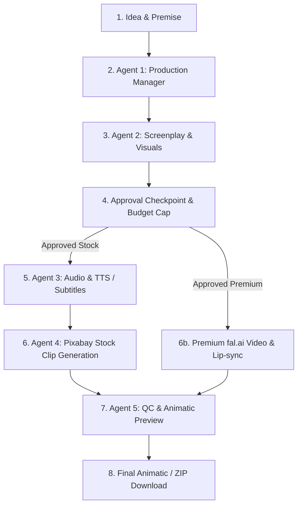

# AI Movie Maker - Development Plan for Next Steps

This document outlines the detailed architectural instructions and execution steps for completing the Hungarian AI Movie Maker MVP (`ai-movie-maker`), following Agents 1 and 2.

## Workflow Architecture

---

## Detailed Step-by-Chief Instructions

### Step 1: Agent 3 — Audio and Timing (`src/lib/tts.ts` or server action)
- **Objective**: Process dialogue shots using verified Gemini TTS or fall back to Hungarian subtitles with estimated duration.
- **Instructions**:
  1. Iterate over all `shots` of an approved project where `dialogue_hu` is not empty.
  2. Invoke Gemini TTS (or configured TTS endpoint) with verification.
  3. If TTS succeeds: store audio file in Supabase Storage (`media_assets`), measure exact audio file duration, set `duration_estimated = false`, and update shot status to `audio_ready`.
  4. If TTS fails or is unavailable: do NOT create fake audio. Create subtitle record with estimated duration from word count, set `duration_estimated = true`, label **“becsült időtartam”**, and set shot status to `audio_ready`.
  5. For shots without dialogue, use target duration and set `audio_ready`.

### Step 2: Agent 4 — Clip Generation (Stock Mode & Premium Mode)
- **Objective**: Generate or fetch visual clips for each shot sequentially within budget constraints.
- **Instructions (Stock Mode - Default)**:
  1. Extract 2-4 plain English keywords from `visual_prompt_en`.
  2. Search landscape Pixabay videos via verified API endpoint.
  3. Match closest duration; if difference exceeds 2 seconds, mark `needs_review`.
  4. Download video, store in Supabase Storage, validate non-emptiness/playability, save attribution and asset record, mark `clip_ready`.
- **Instructions (Premium Mode - fal.ai)**:
  1. Verify active budget cap and ensure actual spend + pending costs remain within cap.
  2. Generate reference image if needed, then call fal.ai image-to-video endpoint asynchronously.
  3. Store and validate resulting video; if lip-sync is enabled and audio exists, execute lip-sync.
  4. On failure/timeout, visibly fall back to stock for that shot only, marked `needs_review`.

### Step 3: Agent 5 — Quality Control and Browser Preview
- **Objective**: Perform QC checks and provide a sequential browser preview labeled **“Animatic / előnézet”**.
- **Instructions**:
  1. Check asset existence, playability, and duration against locked timing.
  2. Set `qc_ok` or `needs_review` with clear notes in `qc_notes`.
  3. Render sequential player with audio/subtitles, trimming or holding last frame as needed.
  4. Provide fallback **“Sorozat letöltése ZIP-ben”** if assembly service is unavailable.

### Step 4: Reliability & Robustness Tests
- **Objective**: Ensure session persistence across refresh, idempotency on retries, and proper 429/quota error handling in Hungarian.
